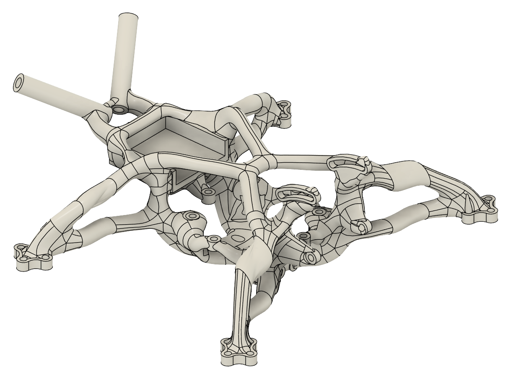
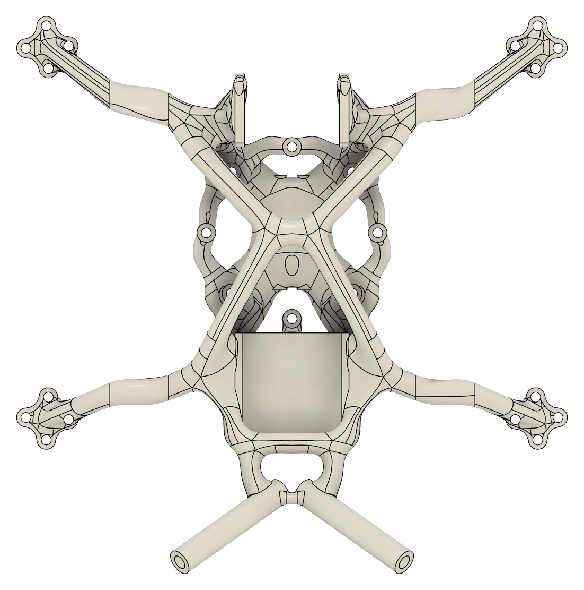
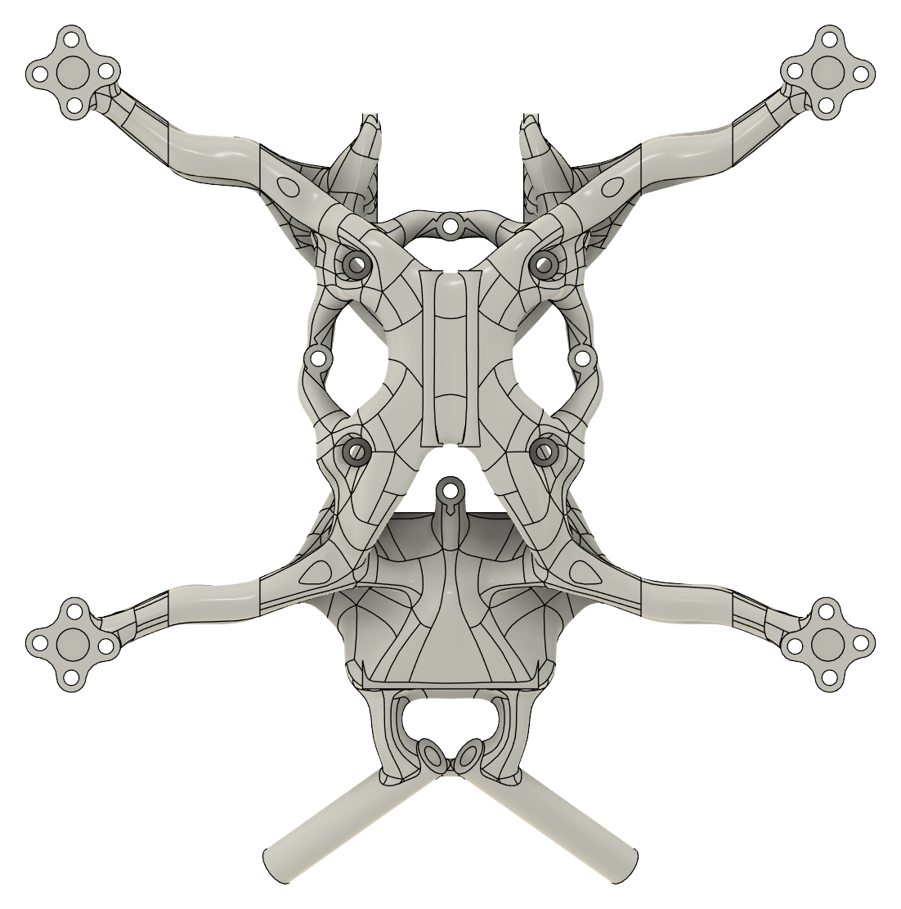
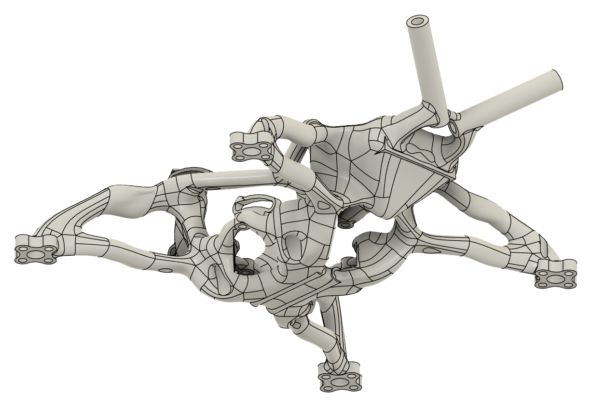
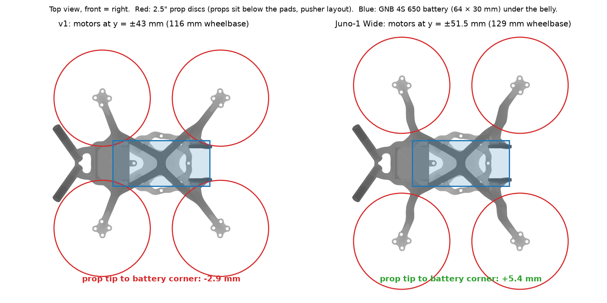
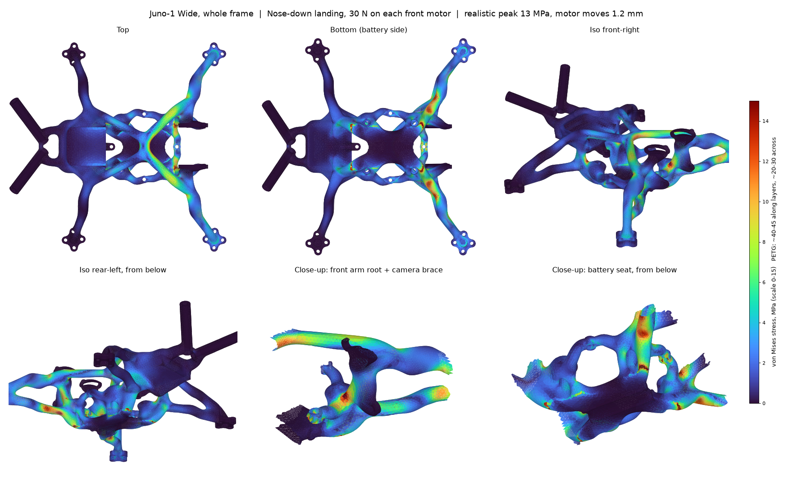
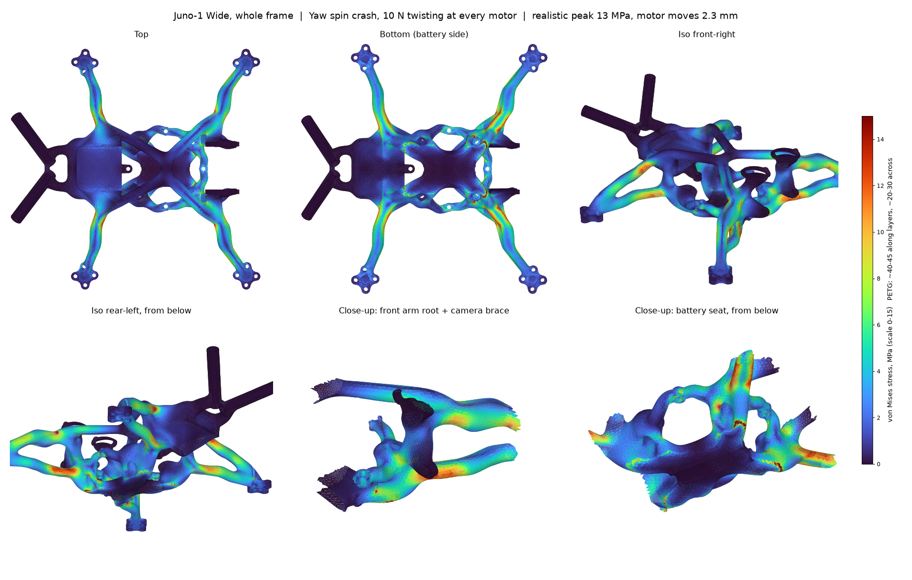

<h1 align="center">Juno-1</h1>

  <strong>A one-piece, 3D-printed 2.5" FPV quad frame I designed, analysed and refined before the first print.</strong> 
  Sculpted tube structure, pusher props, battery underneath, and the stress, vibration and clearance analysis that shaped it.

  

  <a href="#the-frame">The frame</a> ·
  <a href="#what-i-designed-and-analysed">What I did</a> ·
  <a href="fea/README.md">FEA write-up</a> ·
  <a href="docs/design-notes.md">Design notes</a> ·
  <a href="stl"><strong>Download the STLs</strong></a>

<table>
  <tr>
    <td width="33%"> <b>Top.</b> X-braced stack cage, camera at the front, antenna tubes at the rear.</td>
    <td width="33%"> <b>Bottom.</b> Battery rails and strap windows; motors bolt under the pads.</td>
    <td width="33%"> <b>Rear, from below.</b> Twin-strut arms meeting at each motor pad.</td>
  </tr>
</table>

## The frame

Juno-1 is a 2.5" quad frame printed in one piece in PETG. Instead of flat carbon plates, the body and arms are a sculpted tube structure: each arm is a pair of struts that meet at the motor pad, the stack sits in an X-braced cage, the camera hangs off the front and two antenna tubes point back and up. It flies as a **pusher**, with the motors under the pads and the battery strapped under the belly.

This is the first build: the frame is designed, analysed and being printed now. Build photos and flight notes are coming.

| | |
| --- | --- |
| **Size** | 2.5" props, 129 mm wheelbase, 117 × 116 × 44.5 mm overall |
| **Layout** | Pusher: motors and props under the pads |
| **Battery** | 4S, strapped underneath, lying front to back (built around GNB 650 and 850 mAh packs) |
| **Motor mount** | 9 mm M2 pattern, Ø4.5 mm shaft pocket, two screws per motor |
| **Stack** | 25.5 × 25.5 mm whoop-style AIO |
| **Camera** | 19 mm micro camera |
| **Material** | PETG, 4 walls, 20% infill, printed in one piece |
| **CAD** | Fusion, with STEP, F3D and STL files included |

## What I designed and analysed

  

- **Mechanical design.** A sculpted single-piece frame in Fusion, with twin-strut arms, an X-braced stack cage and built-in camera and antenna mounts. See the [design notes](docs/design-notes.md).
- **Analysis before printing.** I ran the first version (v1) through whole-frame finite-element stress analysis in PETG, with a separate check for stress across the print layers, plus free-free vibration analysis, printability checks and prop and battery clearance checks. See the [FEA write-up](fea/README.md).
- **Design changes driven by the analysis.**
  - In a pusher layout, v1's props reached 3 mm into a bottom-mounted 4S battery, so I moved the motors out to a 129 mm wheelbase. I did it by cutting the arms, moving the outer sections and lofting the eight struts back together with tangent ends.
  - A leftover prop-relief cut had left a sharp 90° notch under every arm root. I removed it.
  - Buried inboard screw holes led to a two-screw motor mount, which suits a pusher layout.
- **Open, reproducible tooling.** The FEA pipeline is plain Python (gmsh, scikit-fem, pyamg), so anyone can re-run it on their own revision. See [re-running](fea/README.md#re-running).

<table>
  <tr>
    <td width="50%"> <b>Worst case: nose-down landing.</b> 30 N on each front motor; about 13 MPa realistic peak, a safety factor of about 3 in-layer.</td>
    <td width="50%"> <b>Yaw spin crash.</b> All four arms bend in-plane; the front arms work hardest.</td>
  </tr>
</table>

| Whole-frame load case | Realistic peak | SF in-layer | SF across layers |
| --- | --- | --- | --- |
| Full throttle | 1.5 MPa | 27 | 22 |
| Flat drop, 20 N per motor | 7.7 MPa | 5.2 | 4.3 |
| Nose-down landing, 30 N per front motor | 12.7 MPa | 3.1 | 2.3 |
| Yaw spin crash | 12.8 MPa | 3.1 | 3.5 |

## What this project demonstrates

Organic and sculpted CAD in Fusion, design for FDM printing, finite-element stress and vibration analysis with my own open-source pipeline, using analysis to drive real design changes (layout, clearances and stress risers), and documenting a hardware project so others can build on it.

## Get started

1. Download the Juno-2 frame in two parts, [`stl/Juno-2-Wide-frame-part-1.stl`](stl/Juno-2-Wide-frame-part-1.stl) and [`stl/Juno-2-Wide-frame-part-2.stl`](stl/Juno-2-Wide-frame-part-2.stl), and follow the [print guide](docs/print-guide.md).
2. Build it with the [build guide](docs/build-guide.md). It covers the two-screw motor mount, battery orientation and flight-controller setup.
3. To modify it, start from [`cad/Juno-2-Wide.f3d`](cad/Juno-2-Wide.f3d) (Fusion, editable timeline) or [`cad/Juno-2-Wide.step`](cad/Juno-2-Wide.step), then re-run the [FEA scripts](fea/README.md#re-running) on your version.

## Documentation

| | |
| --- | --- |
| [Design notes](docs/design-notes.md) | How v1 became Juno-1 Wide: what the checks found and what changed |
| [FEA write-up](fea/README.md) | Stress, vibration and print checks, method, limitations and how to re-run |
| [Print guide](docs/print-guide.md) | Slicer settings, supports and known print details |
| [Build guide](docs/build-guide.md) | Layout, parts, motor mounting, battery and flight setup |
| [CAD files](cad/README.md) | STEP and Fusion files for the current frame and v1 |

## License

Released under the [MIT License](LICENSE). Use it, print it, change it.

## Related work

The FEA approach builds on the stress analysis I did for the knee bracket of [Domino](https://github.com/Blacksheep909/Domino-ESP32-Quadruped), my ESP32 robot dog.
