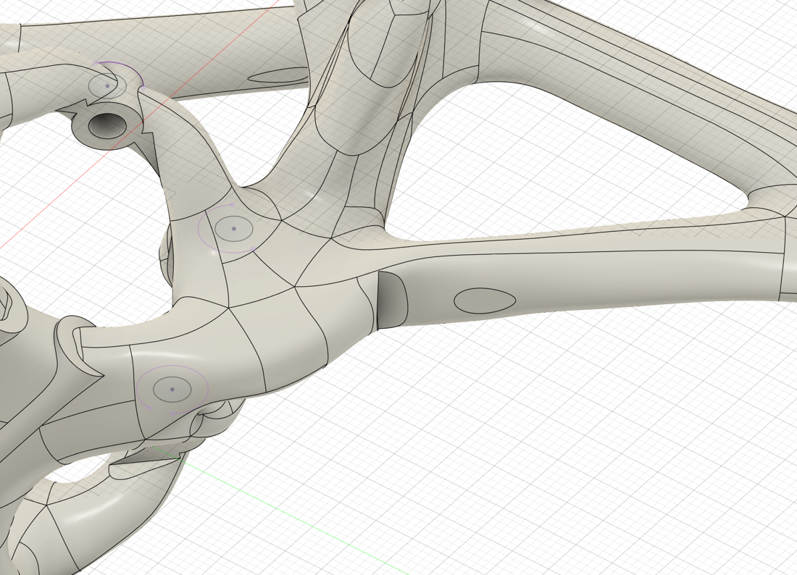
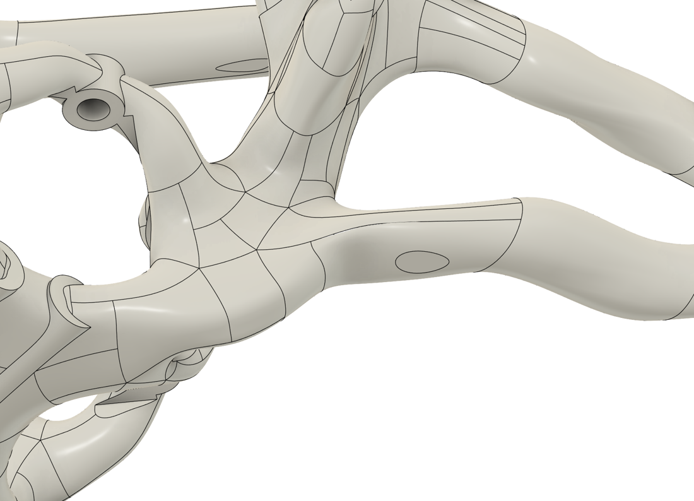

# Design Notes

How Juno-1 went from the first sculpted frame (v1) to the version in this repo (Juno-1 Wide), and why.

## The concept

Juno-1 is a 2.5" FPV quad frame printed in one piece. Instead of flat carbon plates, the body and arms are a sculpted tube structure designed in Fusion: each arm is a pair of struts (upper and lower) that meet at the motor pad, the stack sits in an X-braced cage, the camera hangs off the front, and two antenna tubes point back and up. It is meant to print on a normal FDM printer in PETG.

The layout is **pusher**: the motors bolt to the underside of the pads and the props spin below them. The battery straps underneath the belly.

<table>
  <tr>
    <td width="50%"> <b>Top.</b> X-braced stack cage, camera mount at the front (right), antenna tubes at the rear.</td>
    <td width="50%"> <b>Bottom.</b> Two battery rails down the middle, strap windows either side of the X.</td>
  </tr>
</table>

## v1: what the checks found

v1 had its motors at (±39, ±43) mm, a 116 mm wheelbase. Before printing it I ran it through stress, vibration, printability and clearance checks. The full method is in the [FEA write-up](../fea/README.md); these are the findings that changed the design.

### 1. The props hit the battery

With pusher props the prop discs sit below the pads, and the battery hangs from the belly down through that same height. A 4S 650 mAh pack's corners reached about 3 mm into all four prop discs.

| Battery | v1 clearance at the battery corner |
| --- | --- |
| 3S 450 (55 × 30 mm) | −1.5 mm |
| 4S 450 (57 × 31 mm) | −2.3 mm |
| GNB 4S 650 (64 × 30 mm) | −2.9 mm |
| GNB 4S 650 on its side (64 × 23 mm) | +0.5 mm |
| GNB 4S 850 HV on its side (63 × 26.5 mm) | −1.1 mm |

Turning the battery on its side was not enough, so the options were a much smaller battery, moving the battery to the top, switching to puller props, or spreading the motors. I kept the layout I wanted (pusher, battery underneath, GNB 650/850 packs lying flat) and moved the motors out sideways. The smallest move giving about 5 mm of tip clearance was **y = ±43 → ±51.5 mm**, a 129 mm wheelbase. Moving them fore/aft instead would have needed 132–140 mm.

### 2. The inboard motor screws were buried

On every pad the inboard M2 hole sits 6–9 mm under the arm, so a screw head has nowhere flat to sit. Rather than counterboring through the arm, each motor is held with its two outboard screws. In a pusher layout the thrust pushes the motor into the pad, so the plastic takes thrust and landing loads in compression. See the [build guide](build-guide.md#motor-mounting).

### 3. A 90° notch under every arm root

A Ø64 mm prop-relief cut around each motor had flattened the underside of the arm roots and left a sharp step, right where the stress analysis showed the highest load on the underside of the arms. With the motors moved out, the relief was no longer needed there, so in Juno-1 Wide those faces were deleted and Fusion healed the arm surface back over them.

<table>
  <tr>
    <td width="50%"> <b>v1.</b> The dark stepped face on the lower strut is the notch left by the prop-relief cut.</td>
    <td width="50%"> <b>Juno-1 Wide.</b> Same view, notch removed: the strut flows straight into the body.</td>
  </tr>
</table>

### 4. Smaller findings

- **CAD sliver on the front pads.** The arm surface dips 0.23 mm below the pad top where they meet, leaving a knife-edge and a 0.006 mm² micro-face. It does not affect printing, but it produced degenerate mesh elements that stalled the solver until they were removed. It is still in the CAD.
- **0.24 mm sliver at the rear inboard holes.** Too thin for a 0.4 mm nozzle. Harmless now that those holes are not used.
- **Antenna tube junction.** The peak stress where the two tubes meet kept rising as the mesh got finer, which means a sharp inside corner. A 3 N snag is fine; a hard snag could crack it. A 1 mm fillet or a separate TPU antenna mount would fix it (open item).

## Juno-1 Wide: how the arms were moved

The frame is a single sculpted body, so the arms could not just be re-dimensioned. Each arm is two struts, and between y = 26 and 30 mm each side's cut passes through exactly four strut sections and nothing else. In a copy of the v1 file:

1. Split the body with planes at y = ±26 and ±30 mm.
2. Removed the 4 mm slabs between the cuts.
3. Moved the outer arm pieces out 8.5 mm.
4. Lofted each of the eight struts back together from the cut faces' edge loops, with **tangent end conditions** so they flow into the original surfaces without a kink.
5. Joined everything back into one body.
6. Deleted the old prop-relief notch faces under all four arm roots.

The whole sequence is in the Fusion timeline of [`cad/Juno-2-Wide.f3d`](../cad/Juno-2-Wide.f3d), so it stays editable: lowering the loft tangency weight gives straighter arms with tighter bends at the ends.

| | v1 | Juno-1 Wide |
| --- | --- | --- |
| Motor positions | ±39, ±43 mm | ±39, ±51.5 mm |
| Wheelbase | 116 mm | 129 mm |
| Prop tip to GNB 650 battery | −2.9 mm (hits) | +5.4 mm |
| Prop tip to frame | 2.5–3.5 mm | 5.8–6.8 mm |
| Prop disc covered by the frame | 7.5–8% | 5–7% |
| Modelled solid volume | 25.1 cm³ | 26.9 cm³ |

The longer arms cost about 20% more crash stress at the arm roots and about 50% more motor deflection. The [FEA write-up](../fea/README.md) has the full comparison.

## Open items

Things I would change in a next revision, in priority order:

1. **Widen the front arm roots** about 30–40% in the frame plane for the first 15–20 mm, with a 3 mm+ fillet into the body. This is the main crash weak point and also raises the in-plane vibration modes.
2. **Fillet the front corners of the battery seat** (1.5–2 mm) where the front arms hand their load into the battery.
3. **Antenna tubes:** 1 mm fillet at the junction and Ø6.5 mm OD, or a separate TPU mount.
4. **Hole sizes for FDM:** M2 holes Ø2.1 → Ø2.3–2.4, camera gap 20.0 → 20.4 mm.
5. **Clean up the knife-edge** on the front pads.
6. **Raise the battery seat flush with the pads** (z = −3) so the motor faces and battery rails both print on the bed with far less support.
