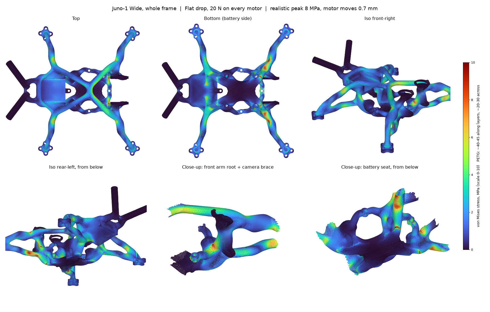
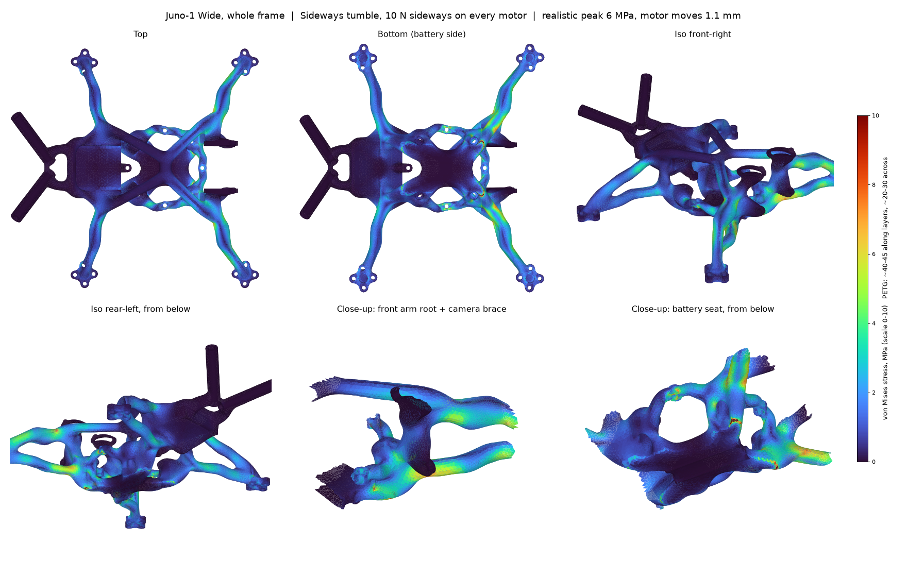
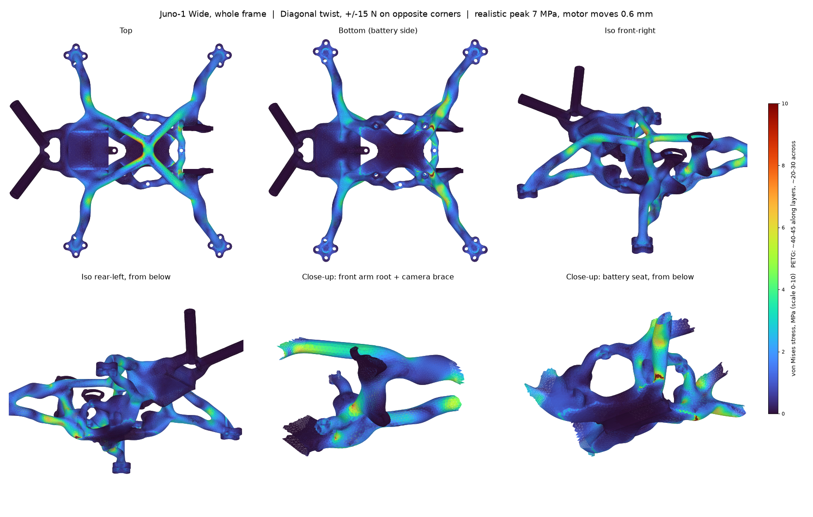

# Juno-1 Frame: Stress, Vibration and Print Checks

Linear static finite-element analysis, free-free vibration analysis and printability/clearance checks of the Juno-1 Wide frame, printed in PETG (4 walls, 20% infill) and flown as a pusher with the battery strapped underneath.

> These results are a design check, not a certification. Read the [limitations](#limitations) before relying on the numbers.


## Result Summary

Flying loads are tiny: full throttle peaks at **1.5 MPa**. The worst crash cases, a hard nose-down landing and a yaw spin into the ground, peak at about **13 MPa**, a safety factor of about **3 within a layer and 2.3 across layers**.

| Load case (all motors loaded) | Realistic peak von Mises | Layer tension | Motor moves | SF in-layer (40 MPa) | SF inter-layer (20 MPa) |
| --- | --- | --- | --- | --- | --- |
| Full throttle, 4 N up per motor | 1.5 MPa | 0.9 MPa | 0.13 mm | 27 | 22 |
| Flat drop, 20 N per motor | 7.7 MPa | 4.7 MPa | 0.66 mm | 5.2 | 4.3 |
| Diagonal twist, ±15 N on opposite corners | 7.1 MPa | 3.9 MPa | 0.61 mm | 5.6 | 5.1 |
| Sideways tumble, 10 N sideways per motor | 6.2 MPa | 2.5 MPa | 1.14 mm | 6.5 | 8.0 |
| **Nose-down landing, 30 N per front motor (worst)** | **12.7 MPa** | **8.6 MPa** | **1.16 mm** | **3.1** | **2.3** |
| **Yaw spin crash, 10 N twisting per motor** | **12.8 MPa** | **5.7 MPa** | **2.32 mm** | **3.1** | **3.5** |

"Realistic peak" leaves out the hottest 0.05% of the frame's volume, a few elements of artificial spike where the loads and the rigid battery support are applied (see [where the stress goes](#where-the-stress-goes)). "Layer tension" is the tensile stress normal to the print layers (σzz, printed Z-up), which is what splits FDM parts. "Motor moves" is the largest motor-pad displacement. All six cases converged to a relative residual of about 1 × 10⁻⁸.

Comparison with v1 (motors at ±43 mm, same loads, support and solver):

| Load case | v1 peak | Juno-1 Wide peak | v1 motor moves | Wide motor moves |
| --- | --- | --- | --- | --- |
| Full throttle | 1.0 MPa | 1.5 MPa | 0.07 mm | 0.13 mm |
| Flat drop | 4.9 MPa | 7.7 MPa | 0.33 mm | 0.66 mm |
| Diagonal twist | 6.4 MPa | 7.1 MPa | 0.33 mm | 0.61 mm |
| Sideways tumble | 7.0 MPa | 6.2 MPa | 0.99 mm | 1.14 mm |
| Nose-down landing | 10.7 MPa | 12.7 MPa | 0.66 mm | 1.16 mm |
| Yaw spin crash | 11.5 MPa | 12.8 MPa | 1.67 mm | 2.32 mm |

v1 motor movement is for the front-left motor only. The longer arms were needed so the props clear the battery (see the [design notes](../docs/design-notes.md)); they cost 10–60% more stress and roughly double the motor movement.

<table>
  <tr>
    <td width="50%"><br><sub><b>Yaw spin crash.</b> All four arms bend in-plane; the front arms work hardest.</sub></td>
    <td width="50%"><br><sub><b>Flat drop.</b> Even, low load across all four arms.</sub></td>
  </tr>
  <tr>
    <td width="50%"><br><sub><b>Sideways tumble.</b></sub></td>
    <td width="50%"><br><sub><b>Diagonal twist.</b></sub></td>
  </tr>
</table>

## Where the stress goes

- **Raw peak, every case: the front corners of the battery seat**, around (16, ±12.5, −9.6) mm, where the front arms hand their load down into the battery. Part of this spike is the model's rigid support edge. In the nose-down landing it drops from 38 MPa to 16 MPa within 2 mm and to 7 MPa by 3 mm. In the yaw spin it holds about 29 MPa out to 2.5 mm, so there is a mild real concentration there in spin crashes. A foam pad under the battery spreads that load more than the rigid support in the model.
- **Next: beside the front stack-hole bosses**, around (17, ±12, 5) mm, up to about 30 MPa locally in a hard nose-in landing. That is along the layers, where PETG manages 40–45 MPa.
- **The X-brace behind the camera** ties the two front arms together and lights up in the nose-down landing.
- **Rear arms and antenna tubes** stay lightly loaded in every case except the yaw spin.

## Vibration

Free-free modes of the whole quad, with each motor and prop (11 g), the battery (75 g under the belly), the stack (10 g) and the camera (5 g) lumped onto the frame. From [`results/modal.json`](results/modal.json):

| Mode | Frequency | What moves |
| --- | --- | --- |
| 1 | **103 Hz** | Front arms swing fore and aft, flat in the frame plane |
| 2 | 106 Hz | All four arms swing in-plane together (a yaw wobble) |
| 3 | 129 Hz | Rear arms swing in-plane |
| 4 | 215 Hz | Antenna tubes sway side to side |
| 5 | **252 Hz** | All four arms flap up and down, antennas following |
| 6 | 353 Hz | Front arms flap up and down |
| 7 | 418 Hz | Antenna tubes bounce vertically |
| 8 | 518 Hz | Antenna tubes sway, second mode |

**What it means for flying:**
- A 2.5" quad on 4S spins its motors at roughly 300–450 Hz around hover and up to about 900 Hz flat out. The 252 Hz and 353 Hz arm-flap modes sit at and just below hover, so the motors will excite them and the gyro will see some resonance.
- The 103–129 Hz in-plane modes are below hover speed but low enough to matter for filtering.
- For comparison, carbon frames' arms typically resonate at 400–600 Hz and above.
- It will fly, but plan on the RPM filter and dynamic notch, soft-mount the flight controller, and check a blackbox log before tuning.

The longer arms lowered every mode by roughly 15–20% compared with v1. Widening the front arm roots (the first [open item](../docs/design-notes.md#open-items)) is the main lever to push the in-plane modes back up.

The modes come from a coarser 2.5 mm mesh, solved with LOBPCG to a relative residual of about 2 × 10⁻⁴. That is accurate to about 1% in frequency.

## Print and Clearance Checks

From [`checks.py`](scripts/checks.py) on the frame STL ([`results/checks.json`](results/checks.json)):

| Check | Result |
| --- | --- |
| Watertight, single body | Yes |
| Enclosed voids | None |
| Thin features under 0.8 mm | 0.24 mm sliver at each rear inboard motor hole (unused, see the [build guide](../docs/build-guide.md)); 0.72 mm skin over each axle pocket |
| Prop tip to frame (below pad level) | 5.8 mm front, 6.8 mm rear |
| Prop tip to battery corner | +5.4 mm (GNB 4S 650, 64 × 30), +5.5 mm (GNB 4S 850 HV), +3.8 mm (73 × 32 pack) |
| Prop disc covered by the frame (top view, outside the motor bell) | 6.8% front, 5.2% rear |
| Overhang needing support (printed Z-up) | 3,223 mm² |

The prop-disc figure is a geometric blockage estimate, not a CFD result. With pusher props the arms sit in the slower inflow above the disc, which is the gentler side to block.

## Load Cases

The quad is assumed to weigh about 160 g ready to fly: a 27 g frame, four 1404-class motors with props at about 11 g each, a 75 g GNB 4S 650 pack, and about 15 g of flight controller, VTX, receiver and camera.

- **Full throttle:** 4 N (about 400 g of thrust) per motor, roughly 10:1 thrust to weight.
- **Flat drop:** 20 N per motor, 80 N total, about a 50 g stop.
- **Nose-down landing:** 30 N on each front motor.
- **Sideways tumble:** 10 N sideways on every motor.
- **Yaw spin crash:** 10 N tangential at every motor, as if the quad lands spinning.
- **Diagonal twist:** +15 N on two opposite motors and −15 N on the other two.

**Boundary conditions:**

- **Fixed:** the battery seat (everything below z = −9.8 mm, the two rails and the belly underside the pack is strapped to). The battery is the heaviest part, so its inertia is what reacts the crash loads.
- **Loads:** each motor's force is spread evenly over the underside of its pad, within 8.5 mm of the shaft. In the pusher layout that is the face the motor bolts against.

## Model

| Item | Value |
| --- | --- |
| Geometry | [`cad/Juno-1-Wide.step`](../cad/Juno-1-Wide.step), the frame body as printed (26.9 cm³ solid) |
| Baseline | [`cad/previous/Juno-1-v1-116mm.step`](../cad/previous/Juno-1-v1-116mm.step), v1 |
| Mesh | gmsh, +Y half meshed and mirrored, quadratic tetrahedra (P2), 1.5 mm max size with curvature refinement; near-zero-volume sliver tets from tiny CAD sliver faces removed (under 0.2 mm³) |
| Solver | scikit-fem assembly, conjugate gradient with a pyamg smoothed-aggregation preconditioner using the rigid-body modes, converged to 1 × 10⁻⁸ |
| Material | PETG, E = 1900 MPa, ν = 0.38, ρ = 1.27 g/cm³, linear elastic and isotropic |
| Strength | 40 MPa in-layer and 20 MPa inter-layer, conservative estimates for FDM PETG (typically 40–45 and 20–30 MPa) |

## Re-running

```bash
cd fea/scripts
pip install -r requirements.txt
python mesh.py ../../cad/Juno-1-Wide.step ../work/frame_1p5.msh --size 1.5
python mesh.py ../../cad/Juno-1-Wide.step ../work/frame_2p5.msh --size 2.5
python solve.py ../work/frame_1p5.msh      # six static cases, about 10 min on a desktop CPU
python render.py ../work/frame_1p5.msh     # six-panel stress maps from the saved results
python modal.py ../work/frame_2p5.msh      # vibration modes, about 15 min
python checks.py ../../stl/Juno-1-Wide-frame.stl
```

`solve.py` writes [`results/static.json`](results/static.json) and per-element stress arrays to `results/arrays/`. The arrays are needed by `render.py` and are not committed, so run `solve.py` before `render.py`. Motor positions, the pad and battery-seat heights, and the material are constants in [`common.py`](scripts/common.py), so a revision that moves the motors needs those updated. `mesh.py` assumes the frame is mirror-symmetric about y = 0.

## Limitations

- **Linear, static and isotropic.** Layer orientation is accounted for only through σzz and the reduced inter-layer strength. Creep, fatigue, real impact dynamics and large deflections are not modelled; the crash cases are equivalent static loads.
- **Idealised supports.** The battery seat is treated as perfectly rigid, which over-states the stress at its edges (see above). A real strapped pack on a foam pad is softer.
- **Idealised motor contact.** Motor forces are spread evenly over each pad's underside. The two-screw mounting and real bolt bearing are not modelled.
- **No CFD.** Prop wash is only checked geometrically (how much of each prop disc the frame covers).
- **Print quality matters more than these numbers.** Weak layer adhesion, voids or under-extrusion will dominate before the stresses shown here do.

## Files

```
fea/
├─ README.md                 this write-up
├─ scripts/
│  ├─ common.py              material, geometry constants, shared FE model
│  ├─ mesh.py                STEP -> half mesh -> mirrored, sliver-cleaned tet mesh
│  ├─ solve.py               whole-frame static load cases
│  ├─ render.py              six-panel stress maps
│  ├─ modal.py               free-free vibration with lumped components
│  ├─ checks.py              printability, prop and battery clearance, prop-disc blockage
│  └─ requirements.txt
└─ results/
   ├─ static.json            static results (peaks, displacements, solver residuals)
   ├─ modal.json             vibration modes
   ├─ checks.json            print and clearance checks
   └─ images/                stress maps per load case
```
